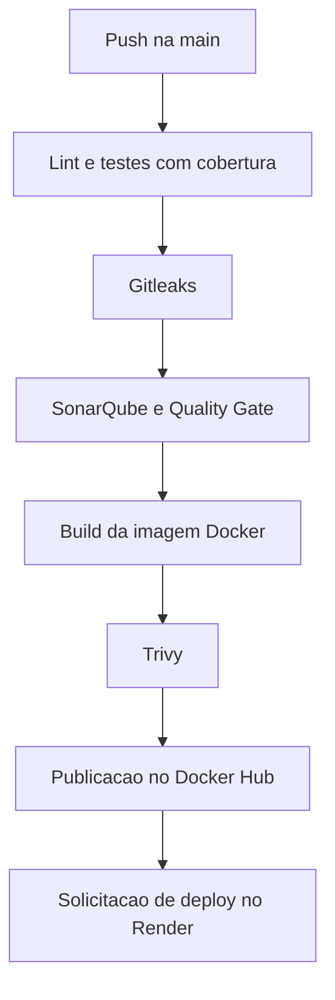

# Trilha de Infraestrutura

Documentação técnica da infraestrutura da API de gerenciamento de biblioteca para o desafio 2026.2 da Comp Júnior.

## Arquitetura da pipeline

O GitHub Actions automatiza a verificação do código, a preparação da imagem Docker e a entrega da aplicação no Render. Na branch `main`, os blocos seguem esta sequência e dependem da aprovação das etapas anteriores.

| Etapa | Responsabilidade |
| --- | --- |
| Lint e testes | O ESLint verifica o código, e o Vitest executa testes unitários e de integração e gera a cobertura |
| Análise de segredos | O Gitleaks examina o histórico do Git para identificar possíveis credenciais publicadas por engano |
| Análise de qualidade | O SonarQube identifica problemas no código e aplica o Quality Gate |
| Build e segurança da imagem | O Docker prepara a imagem, e o Trivy verifica os pacotes do sistema operacional e as bibliotecas incluídas |
| Publicação | A imagem aprovada é enviada ao Docker Hub |
| Deploy | A pipeline solicita ao Render a execução da versão publicada |

Os testes unitários verificam regras isoladas. Os de integração exercitam requisições da API com um PostgreSQL real, incluindo autenticação, usuários, livros, empréstimos e recuperação de senha. O relatório registra quanto do código foi executado nos testes e permite conferir a meta de 70% de cobertura de linhas. Ele é guardado no Actions e importado pelo SonarQube na mesma execução.

A imagem é construída antes da varredura para que o Trivy examine o conteúdo que será entregue. O mesmo conteúdo aprovado é publicado com uma etiqueta correspondente ao identificador do commit. Essa etiqueta é informada ao Render, permitindo relacionar a versão executada ao código e à pipeline que a verificou.

No Render, a API e o PostgreSQL são serviços separados, na mesma região, conectados pela rede interna. Ao iniciar, o contêiner executa as migrações para preparar as tabelas e depois inicia o servidor.

O sucesso do job de deploy confirma que o Render aceitou a solicitação. A conclusão é conferida pelo estado `Live` e pela resposta HTTP 200 em `/health`, que consulta o banco e informa se a aplicação está conectada.

## Decisões de segurança

- **Credenciais fora do código.** Tokens de publicação e deploy ficam nos secrets do GitHub. As credenciais da aplicação ficam nas variáveis de ambiente do Render. O `.env` local é excluído do versionamento e da construção da imagem.
- **Permissões limitadas na pipeline.** O acesso ao repositório utiliza permissão de leitura, e a credencial do checkout é removida da cópia de trabalho após o download.
- **Banco exclusivo para testes.** A conexão é separada do banco da aplicação. Antes de limpar os dados, o projeto confere se está conectado ao ambiente de testes esperado.
- **Exceções específicas no Gitleaks.** As ocorrências ignoradas foram revisadas e correspondem a valores fictícios dos testes ou à credencial inicial da instância descartável do SonarQube. As exceções identificam cada ocorrência por arquivo e commit.
- **Imagem com múltiplos estágios.** Um estágio instala as dependências. O estágio final recebe o Node.js, as dependências de produção, o código e as migrações. O npm fica na preparação, o que resolveu as vulnerabilidades encontradas em seus pacotes internos na imagem inicial.
- **Usuário de execução limitado.** A API utiliza um usuário próprio dentro do contêiner, restringindo as permissões disponíveis ao processo.
- **Bloqueio de vulnerabilidades.** A política do Trivy interrompe o fluxo ao encontrar vulnerabilidades altas ou críticas, inclusive quando ainda não há versão corrigida disponível.

## Funcionamento do Quality Gate

O Quality Gate transforma a análise do SonarQube em uma decisão de aprovação ou reprovação. O gate `Biblioteca CI` avalia o código inteiro e exige nota **A** nas três dimensões abaixo.

| Critério | O que representa |
| --- | --- |
| Segurança | Problemas no código que podem afetar a proteção da aplicação |
| Confiabilidade | Problemas que podem provocar falhas no funcionamento |
| Manutenibilidade | Classificação do esforço estimado para corrigir problemas de manutenção em relação ao tamanho do código |

O SonarQube Community Build é iniciado em um contêiner temporário na máquina do GitHub Actions, acessível apenas nessa máquina. A pipeline aguarda o servidor ficar disponível e cria o projeto, o gate e o token de análise automaticamente.

O scanner lê o código, envia os resultados e aguarda a decisão do servidor. Quando qualquer critério reprova, o job falha e bloqueia a publicação e o deploy na `main`. Ao final da execução, o histórico do painel é descartado junto com o contêiner, e o resultado do gate permanece nos logs do Actions.

Na validação inicial, o gate reprovou duas verificações de e-mail com processamento repetitivo e a divulgação do cabeçalho de identificação do Express. As correções foram verificadas pelos testes e por uma nova análise aprovada, demonstrando o funcionamento do bloqueio.

## Fluxo de branches

A preparação inicial utilizou `infra/validacao-inicial`. Os testes e a pipeline avançaram na `infra/qualidade-testes`, com commits progressivos para cada bloco funcional. Isso permitiu verificar as etapas ao longo do desenvolvimento e testar a publicação no Docker Hub antes da integração.

A união com `main` foi feita por merge local, registrando a integração em um commit. As correções apontadas na validação final foram publicadas diretamente na `main` e passaram pelo fluxo completo.

| Branch | Comportamento atual |
| --- | --- |
| `main` | Executa todas as etapas, publica a imagem identificada pelo commit, atualiza `latest` e solicita o deploy |
| `infra/qualidade-testes` | Executa lint, testes, Gitleaks, build e Trivy e publica a imagem identificada pelo commit |
| Outras branches | Executam lint, testes e Gitleaks |

A [execução validada](https://github.com/WillianCustodio-lab/gerenciamento-biblioteca-api/actions/runs/42415436418) aprovou todas as etapas, com 87 testes e 72,81% de cobertura de linhas. Após o deploy, a [API no Render](https://gerenciamento-biblioteca-api.onrender.com/health) respondeu com o banco conectado. As imagens estão disponíveis no [Docker Hub](https://hub.docker.com/r/williancustodio/gerenciamento-biblioteca-api/tags).
