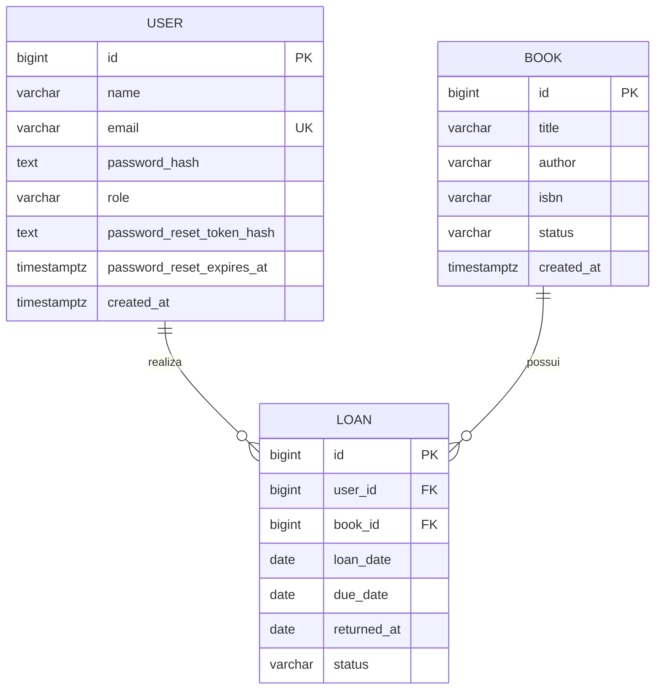

# Sistema de Gerenciamento de Biblioteca

Projeto referente ao processo trainee da Comp Júnior.

API para organizar usuários, exemplares de livros e empréstimos de uma biblioteca. O administrador mantém o catálogo e registra retiradas e devoluções. O usuário comum consulta os livros, acompanha os próprios empréstimos e atualiza seu cadastro.

Cada registro de livro representa um exemplar físico. O sistema preserva o histórico para identificar quem retirou cada exemplar e quando ele foi devolvido.

## Navegação

- [Tecnologias](#tecnologias)
- [Configuração e execução](#configuração-e-execução)
- [Primeiro administrador](#primeiro-administrador)
- [Collection do Postman](#collection-do-postman)
- [Modelagem e DER](#modelagem-e-der)
- [Regras e permissões](#regras-e-permissões)
- [Integração com a Open Library](#integração-com-a-open-library)
- [Documentação das rotas](#documentação-das-rotas)

## Tecnologias

| Tecnologia | Uso |
| --- | --- |
| JavaScript e Node.js 24 | Execução da aplicação |
| Express | Rotas HTTP e middlewares |
| PostgreSQL 17 | Persistência dos dados |
| node-pg-migrate | Criação e evolução das tabelas |
| bcryptjs e jsonwebtoken | Hash de senhas e autenticação JWT |
| Nodemailer | Envio da recuperação de senha por SMTP |
| Open Library | Consulta de dados de livros pelo ISBN |
| Docker e Docker Compose | Execução da API e do banco |
| Postman | Collection para avaliação das rotas |
| ESLint e Vitest | Análise do código e testes automatizados |

## Configuração e execução

Pré-requisitos: Git, Docker com Compose, Postman e acesso à internet.

### 1 Obter o projeto

```bash
git clone https://github.com/WillianCustodio-lab/gerenciamento-biblioteca-api.git
cd gerenciamento-biblioteca-api
```

### 2 Preparar o ambiente

Copie `.env.example` para `.env`:

```bash
cp .env.example .env
```

No PowerShell, utilize `Copy-Item .env.example .env`.

Preencha as credenciais do banco e do SMTP conforme o arquivo de exemplo e substitua a chave `JWT_SECRET`.

### 3 Configurar o envio de e-mails

Quem executar o projeto deve configurar no `.env` uma conta de envio à qual tenha acesso. Defina o remetente em `EMAIL_FROM` e preencha as credenciais SMTP dessa conta. O projeto não fornece uma conta de e-mail nem credenciais compartilhadas.

No Gmail, o proprietário da conta deve ativar a verificação em duas etapas e gerar uma [senha de aplicativo](https://support.google.com/accounts/answer/185833?hl=pt-BR), quando esse recurso estiver disponível. Configure:

```dotenv
SMTP_HOST=smtp.gmail.com
SMTP_PORT=587
SMTP_SECURE=false
SMTP_USER=email_da_conta_remetente@gmail.com
SMTP_PASSWORD=senha_de_aplicativo_dessa_conta
EMAIL_FROM=email_da_conta_remetente@gmail.com
```

Utilize a senha de aplicativo, não a senha normal do Gmail. Ela deve ser gerada na mesma conta utilizada como remetente e não deve ser publicada no repositório.

O e-mail de recuperação será enviado para a conta cadastrada na biblioteca. Para testar o recebimento, utilize um destinatário ao qual tenha acesso.

### 4 Iniciar aplicação e banco

```bash
docker compose up -d --build
```

O endereço padrão da API é `http://localhost:3000`.

## Primeiro administrador

Com a API em execução e as migrations concluídas, abra um terminal interativo na raiz do projeto:

```bash
docker compose exec app npm run create-admin
```

O comando solicita nome, e-mail, senha e confirmação. A senha fica oculta durante a digitação, e ao final, ele cria uma conta nova com perfil `admin`

- Utilize um e-mail ainda não cadastrado.
- A senha precisa ter pelo menos oito caracteres.
- E-mail existente ou confirmação incorreta são recusados sem alterar outra conta.

Guarde essas credenciais para o login no Postman.

## Collection do Postman

Importe [postman/biblioteca.postman_collection.json](postman/biblioteca.postman_collection.json) com as requisições do projeto.

Em **Variables**, confira `base_url` e preencha `user_email`, `user_password`, `admin_email` e `admin_password`. Utilize contas diferentes; a administrativa deve ser criada pelo comando `create-admin`.

Cadastre a conta comum, execute os dois logins e siga as descrições das requisições. Para recuperação, informe também `reset_token` e `new_password` conforme o e-mail recebido.

## Modelagem e DER

- **User:** pessoa cadastrada, com perfil `user` ou `admin`. Guarda dados de identificação, hash de senha e informações temporárias de recuperação.
- **Book:** exemplar físico com título, autor, ISBN e disponibilidade.
- **Loan:** empréstimo de um exemplar para um usuário, com datas e situação.

Um usuário e um exemplar podem participar de vários empréstimos ao longo do tempo. Cada empréstimo pertence a exatamente um usuário e um exemplar. Um exemplar pode ter apenas um empréstimo ativo.



O ISBN identifica uma edição da obra e pode se repetir entre exemplares. O `id` distingue cada exemplar da biblioteca. Por isso, o ISBN não possui restrição de unicidade.

Os campos de recuperação podem ficar nulos. `returned_at` permanece nulo até a devolução.

## Regras e permissões

### Regras de negócio

1. Cada usuário possui um e-mail único. O cadastro público atribui perfil `user`.
2. O usuário autenticado consulta e atualiza somente o próprio cadastro pela rota `/users/me`. A atualização altera nome e e-mail, sem mudar senha ou perfil.
3. Apenas administradores mantêm o catálogo, registram empréstimos e devoluções e listam ou excluem usuários.
4. Um empréstimo exige usuário e exemplar cadastrados, livro disponível e data prevista posterior à data atual.
5. Um usuário pode ter vários empréstimos ativos de exemplares diferentes. O mesmo exemplar não pode ter dois empréstimos ativos.
6. A criação de um empréstimo altera o livro para `loaned`. A devolução altera o empréstimo para `returned`, grava `returned_at` e torna o livro `available`.
7. O prazo não devolve o livro automaticamente. A disponibilidade muda somente ao registrar a devolução.
8. Criação e devolução utilizam transações: o empréstimo e o livro são atualizados juntos. O banco também impede mais de um empréstimo ativo por exemplar.
9. Livros e usuários com qualquer histórico de empréstimos não podem ser excluídos, mesmo após a devolução. O administrador não pode excluir a própria conta pela rota de exclusão.
10. Empréstimos permanecem no histórico. Não há `DELETE /loans` nem atualização livre de usuário, exemplar ou datas do empréstimo; a alteração prevista no escopo é a devolução.
11. O cadastro manual de livros continua disponível quando a Open Library não encontra o ISBN ou retorna informações incompletas.

### Acesso por perfil

| Operação | Usuário comum | Administrador |
| --- | --- | --- |
| Consultar livros | Permitido | Permitido |
| Cadastrar, importar, atualizar e excluir livros | Não permitido | Permitido |
| Consultar e atualizar o próprio cadastro | Permitido | Permitido |
| Listar e excluir outros usuários | Não permitido | Permitido, respeitando o histórico |
| Consultar empréstimos | Somente os próprios | Todos |
| Registrar empréstimo e devolução | Não permitido | Permitido |

## Integração com a Open Library

`POST /books/import` utiliza o ISBN para buscar título e autores e cadastrar um novo exemplar no banco local. Isso reduz a digitação no cadastro do catálogo.

A aplicação consulta a [edição por ISBN](https://openlibrary.org/dev/docs/api/books) e os [autores](https://openlibrary.org/dev/docs/api/authors) pela API pública da Open Library.

## Documentação das rotas

Endereço padrão: `http://localhost:3000`. Os caminhos abaixo são relativos a esse endereço.

Para corpos JSON, envie `Content-Type: application/json`. Nas rotas autenticadas, envie:

```http
Authorization: Bearer SEU_TOKEN_JWT
```

Os exemplos são ilustrativos. Substitua IDs e credenciais pelos registros criados no seu ambiente e escolha datas futuras ao registrar empréstimos. Identificadores `bigint` são retornados como texto pelo driver PostgreSQL. Datas podem ser serializadas em ISO, como `2030-01-01T00:00:00.000Z`.

| Método | Caminho | Acesso |
| --- | --- | --- |
| `GET` | `/health` | Público |
| `POST` | `/auth/register` | Público |
| `POST` | `/auth/login` | Público |
| `POST` | `/auth/forgot-password` | Público |
| `POST` | `/auth/reset-password` | Público |
| `GET` | `/users/me` | Autenticado |
| `PUT` | `/users/me` | Autenticado |
| `GET` | `/users` | Administrador |
| `DELETE` | `/users/:id` | Administrador |
| `POST` | `/books` | Administrador |
| `POST` | `/books/import` | Administrador |
| `GET` | `/books` | Autenticado |
| `GET` | `/books/:id` | Autenticado |
| `PUT` | `/books/:id` | Administrador |
| `DELETE` | `/books/:id` | Administrador |
| `POST` | `/loans` | Administrador |
| `GET` | `/loans` | Autenticado |
| `GET` | `/loans/:id` | Autenticado |
| `PATCH` | `/loans/:id/return` | Administrador |

Expanda cada operação para consultar os campos e exemplos de requisição e resposta.

<details>
<summary><strong>GET /health</strong> — Verificar API e banco</summary>

Acesso: **Público**. Confirma se a API consegue consultar o PostgreSQL.

```http
GET /health
```

Sem corpo.

Resposta `200`:

```json
{
  "status": "ok",
  "database": "connected",
  "databaseTime": "2030-01-01T12:00:00.000Z"
}
```

Se o banco estiver indisponível, retorna `503` com `{"status":"error","database":"disconnected"}`.

</details>

<details>
<summary><strong>POST /auth/register</strong> — Cadastrar usuário comum</summary>

Acesso: **Público**. Campos obrigatórios: `name`, `email` e `password`. A senha deve possuir pelo menos oito caracteres.

```http
POST /auth/register
```

Corpo JSON:

```json
{
  "name": "João Silva",
  "email": "joao@example.com",
  "password": "SenhaTeste123"
}
```

Resposta `201`:

```json
{
  "message": "Usuário cadastrado com sucesso.",
  "user": {
    "id": "1",
    "name": "João Silva",
    "email": "joao@example.com",
    "role": "user",
    "created_at": "2030-01-01T12:00:00.000Z"
  }
}
```

Não há campo opcional para escolher perfil. E-mail já cadastrado retorna `409`.

</details>

<details>
<summary><strong>POST /auth/login</strong> — Obter token de acesso</summary>

Acesso: **Público**. Campos obrigatórios: `email` e `password` de uma conta existente. Serve aos dois perfis.

```http
POST /auth/login
```

Corpo JSON:

```json
{
  "email": "joao@example.com",
  "password": "SenhaTeste123"
}
```

Resposta `200`:

```json
{
  "message": "Login realizado com sucesso.",
  "token": "JWT_GERADO_NO_LOGIN",
  "user": {
    "id": "1",
    "name": "João Silva",
    "email": "joao@example.com",
    "role": "user"
  }
}
```

Credenciais incorretas retornam `401`. No Postman, os logins guardam o JWT automaticamente.

</details>

<details>
<summary><strong>POST /auth/forgot-password</strong> — Solicitar recuperação de senha</summary>

Acesso: **Público**. Campo obrigatório: `email`. A conta cadastrada recebe um código, desde que o SMTP esteja configurado.

```http
POST /auth/forgot-password
```

Corpo JSON:

```json
{
  "email": "joao@example.com"
}
```

Resposta `200`:

```json
{
  "message": "Se o e-mail estiver cadastrado, as instruções serão enviadas."
}
```

A mesma mensagem é utilizada para e-mails não cadastrados. O código expira em 15 minutos; ele não é o JWT.

</details>

<details>
<summary><strong>POST /auth/reset-password</strong> — Definir nova senha</summary>

Acesso: **Público**. Campos obrigatórios: `token`, recebido por e-mail, e `password`, com pelo menos oito caracteres.

```http
POST /auth/reset-password
```

Corpo JSON:

```json
{
  "token": "CODIGO_RECEBIDO_POR_EMAIL",
  "password": "NovaSenhaTeste123"
}
```

Resposta `200`:

```json
{
  "message": "Senha alterada com sucesso."
}
```

Código inválido ou expirado retorna `400`. Após o sucesso, faça login com a nova senha.

</details>

<details>
<summary><strong>GET /users/me</strong> — Consultar próprio cadastro</summary>

Acesso: **Autenticado**. A conta é identificada pelo token, sem informar ID.

```http
GET /users/me
```

Sem corpo.

Resposta `200`:

```json
{
  "user": {
    "id": "1",
    "name": "João Silva",
    "email": "joao@example.com",
    "role": "user",
    "created_at": "2030-01-01T12:00:00.000Z"
  }
}
```

</details>

<details>
<summary><strong>PUT /users/me</strong> — Atualizar próprio cadastro</summary>

Acesso: **Autenticado**. Campos obrigatórios: `name` e `email`. Envie ambos mesmo quando quiser alterar apenas um.

```http
PUT /users/me
```

Corpo JSON:

```json
{
  "name": "João atualizado",
  "email": "joao@example.com"
}
```

Resposta `200`:

```json
{
  "message": "Cadastro atualizado com sucesso.",
  "user": {
    "id": "1",
    "name": "João atualizado",
    "email": "joao@example.com",
    "role": "user",
    "created_at": "2030-01-01T12:00:00.000Z"
  }
}
```

Limites: nome com até 120 caracteres e e-mail com até 255. E-mail inválido retorna `400`; pertencente a outra conta, `409`. Senha e perfil não são alterados. Se mudar o e-mail, utilize o novo no próximo login.

</details>

<details>
<summary><strong>GET /users</strong> — Listar usuários</summary>

Acesso: **Administrador**. Retorna os dados públicos das contas cadastradas.

```http
GET /users
```

Sem corpo.

Resposta `200`:

```json
{
  "users": [
    {
      "id": "1",
      "name": "João Silva",
      "email": "joao@example.com",
      "role": "user",
      "created_at": "2030-01-01T12:00:00.000Z"
    }
  ]
}
```

Usuário comum recebe `403`.

</details>

<details>
<summary><strong>DELETE /users/:id</strong> — Excluir usuário</summary>

Acesso: **Administrador**. Parâmetro obrigatório: `id`, inteiro positivo. Exclui somente uma conta sem histórico de empréstimos.

```http
DELETE /users/1
```

Sem corpo.

Resposta `200`:

```json
{
  "message": "Usuário excluído com sucesso.",
  "user": {
    "id": "1",
    "name": "João Silva",
    "email": "joao@example.com",
    "role": "user",
    "created_at": "2030-01-01T12:00:00.000Z"
  }
}
```

Conta inexistente retorna `404`. Histórico de empréstimos ou tentativa de excluir a própria conta retorna `409`. O ID do exemplo deve ser de uma conta separada, criada para testar exclusão.

</details>

<details>
<summary><strong>POST /books</strong> — Cadastrar exemplar manualmente</summary>

Acesso: **Administrador**. Campos obrigatórios: `title`, `author` e `isbn`. O exemplar inicia disponível.

```http
POST /books
```

Corpo JSON:

```json
{
  "title": "Matilda",
  "author": "Roald Dahl",
  "isbn": "9780140328721"
}
```

Resposta `201`:

```json
{
  "message": "Livro cadastrado com sucesso.",
  "book": {
    "id": "1",
    "title": "Matilda",
    "author": "Roald Dahl",
    "isbn": "9780140328721",
    "status": "available",
    "created_at": "2030-01-01T12:00:00.000Z"
  }
}
```

Limites: título com até 255 caracteres e autor com até 160. O ISBN deve ser enviado como texto no formato de 10 ou 13 caracteres; espaços e hífens são removidos. Não há parâmetros opcionais.

</details>

<details>
<summary><strong>POST /books/import</strong> — Cadastrar exemplar pelo ISBN</summary>

Acesso: **Administrador**. Campo obrigatório: `isbn`. Título e autor são consultados na Open Library.

```http
POST /books/import
```

Corpo JSON:

```json
{
  "isbn": "9780140328721"
}
```

Resposta `201`:

```json
{
  "message": "Livro importado e cadastrado com sucesso.",
  "book": {
    "id": "1",
    "title": "Matilda",
    "author": "Roald Dahl",
    "isbn": "9780140328721",
    "status": "available",
    "created_at": "2030-01-01T12:00:00.000Z"
  }
}
```

Cada envio bem-sucedido cria outro exemplar. As falhas externas e a alternativa manual estão descritas na seção de integração.

</details>

<details>
<summary><strong>GET /books</strong> — Listar e filtrar livros</summary>

Acesso: **Autenticado**. Filtro opcional de query: `status`, aceitando `available` ou `loaned`. Sem o filtro, retorna todos.

```http
GET /books
```

Sem corpo.

Resposta `200`:

```json
{
  "books": [
    {
      "id": "1",
      "title": "Matilda",
      "author": "Roald Dahl",
      "isbn": "9780140328721",
      "status": "available",
      "created_at": "2030-01-01T12:00:00.000Z"
    }
  ]
}
```

Exemplo com filtro: `GET /books?status=available`. Status desconhecido retorna `400`.

</details>

<details>
<summary><strong>GET /books/:id</strong> — Consultar exemplar</summary>

Acesso: **Autenticado**. Parâmetro obrigatório: `id`, inteiro positivo.

```http
GET /books/1
```

Sem corpo.

Resposta `200`:

```json
{
  "book": {
    "id": "1",
    "title": "Matilda",
    "author": "Roald Dahl",
    "isbn": "9780140328721",
    "status": "available",
    "created_at": "2030-01-01T12:00:00.000Z"
  }
}
```

Exemplar inexistente retorna `404`.

</details>

<details>
<summary><strong>PUT /books/:id</strong> — Atualizar exemplar</summary>

Acesso: **Administrador**. Parâmetro obrigatório: `id`. Campos obrigatórios: `title`, `author` e `isbn`, como no cadastro.

```http
PUT /books/1
```

Corpo JSON:

```json
{
  "title": "Matilda",
  "author": "Roald Dahl",
  "isbn": "9780140328721"
}
```

Resposta `200`:

```json
{
  "message": "Livro atualizado com sucesso.",
  "book": {
    "id": "1",
    "title": "Matilda",
    "author": "Roald Dahl",
    "isbn": "9780140328721",
    "status": "available",
    "created_at": "2030-01-01T12:00:00.000Z"
  }
}
```

A disponibilidade não é alterada por esta rota. Exemplar inexistente retorna `404`.

</details>

<details>
<summary><strong>DELETE /books/:id</strong> — Excluir exemplar</summary>

Acesso: **Administrador**. Parâmetro obrigatório: `id`. Exclui somente um exemplar sem histórico de empréstimos.

```http
DELETE /books/1
```

Sem corpo.

Resposta `200`:

```json
{
  "message": "Livro excluído com sucesso.",
  "book": {
    "id": "1",
    "title": "Matilda",
    "author": "Roald Dahl",
    "isbn": "9780140328721",
    "status": "available",
    "created_at": "2030-01-01T12:00:00.000Z"
  }
}
```

Histórico ativo ou devolvido impede a exclusão e retorna `409`. Exemplar inexistente retorna `404`. Use um exemplar separado para testar.

</details>

<details>
<summary><strong>POST /loans</strong> — Registrar empréstimo</summary>

Acesso: **Administrador**. Campos obrigatórios: `user_id`, `book_id` e `due_date`. A data do empréstimo é definida pelo banco.

```http
POST /loans
```

Corpo JSON:

```json
{
  "user_id": 1,
  "book_id": 1,
  "due_date": "2030-01-08"
}
```

Resposta `201`:

```json
{
  "message": "Empréstimo registrado com sucesso.",
  "loan": {
    "id": "1",
    "user_id": "1",
    "book_id": "1",
    "loan_date": "2030-01-01T00:00:00.000Z",
    "due_date": "2030-01-08T00:00:00.000Z",
    "returned_at": null,
    "status": "active"
  }
}
```

Envie `due_date` como `AAAA-MM-DD`, posterior à data atual; ajuste a data ilustrativa. Usuário ou livro inexistente retorna `404`. Livro indisponível retorna `409`. Não envie `status` ou `loan_date` para definir o estado inicial.

</details>

<details>
<summary><strong>GET /loans</strong> — Listar e filtrar empréstimos</summary>

Acesso: **Autenticado**. Admin visualiza todos; usuário comum, somente os próprios. Filtro opcional: `status`, aceitando `active` ou `returned`.

```http
GET /loans
```

Sem corpo.

Resposta `200`:

```json
{
  "loans": [
    {
      "id": "1",
      "user_id": "1",
      "book_id": "1",
      "loan_date": "2030-01-01T00:00:00.000Z",
      "due_date": "2030-01-08T00:00:00.000Z",
      "returned_at": null,
      "status": "active",
      "user_name": "João Silva",
      "book_title": "Matilda",
      "book_isbn": "9780140328721"
    }
  ]
}
```

Exemplo: `GET /loans?status=active`. As consultas incluem nome do usuário, título e ISBN do livro. Status desconhecido retorna `400`.

</details>

<details>
<summary><strong>GET /loans/:id</strong> — Consultar empréstimo</summary>

Acesso: **Autenticado**. Parâmetro obrigatório: `id`. Admin pode consultar qualquer empréstimo; usuário comum, somente o próprio.

```http
GET /loans/1
```

Sem corpo.

Resposta `200`:

```json
{
  "loan": {
    "id": "1",
    "user_id": "1",
    "book_id": "1",
    "loan_date": "2030-01-01T00:00:00.000Z",
    "due_date": "2030-01-08T00:00:00.000Z",
    "returned_at": null,
    "status": "active",
    "user_name": "João Silva",
    "book_title": "Matilda",
    "book_isbn": "9780140328721"
  }
}
```

Empréstimo inexistente ou não pertencente ao usuário comum retorna `404`.

</details>

<details>
<summary><strong>PATCH /loans/:id/return</strong> — Registrar devolução</summary>

Acesso: **Administrador**. Parâmetro obrigatório: `id`. Registra a data atual e libera o exemplar na mesma transação.

```http
PATCH /loans/1/return
```

Sem corpo.

Resposta `200`:

```json
{
  "message": "Devolução registrada com sucesso.",
  "loan": {
    "id": "1",
    "user_id": "1",
    "book_id": "1",
    "loan_date": "2030-01-01T00:00:00.000Z",
    "due_date": "2030-01-08T00:00:00.000Z",
    "returned_at": "2030-01-02T00:00:00.000Z",
    "status": "returned"
  }
}
```

Empréstimo inexistente retorna `404`; já devolvido, `409`. A data limite, sozinha, não libera o livro.

</details>
